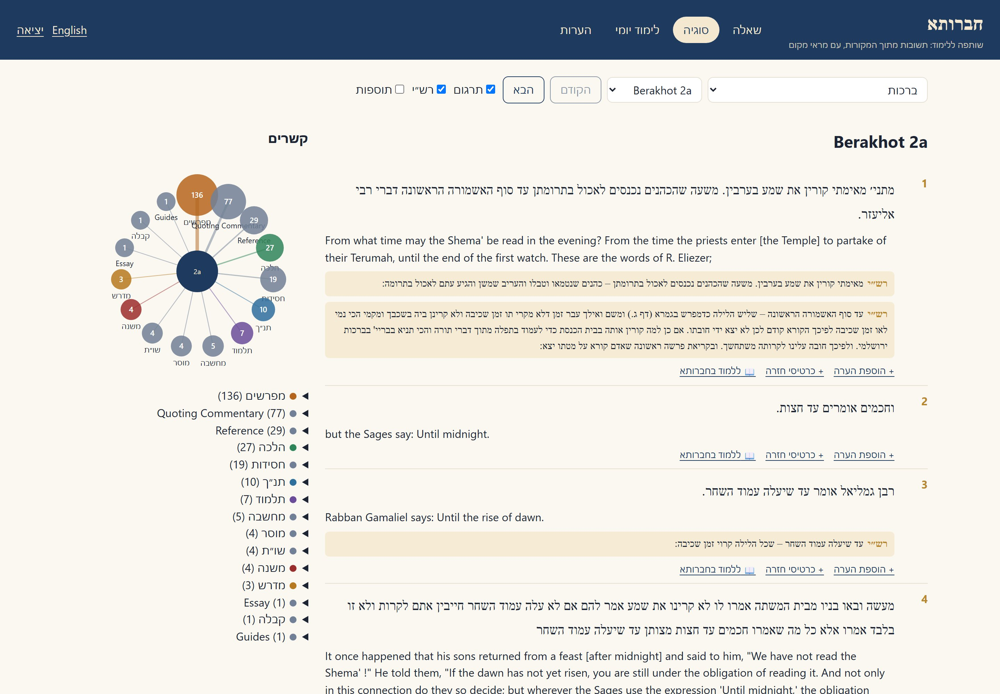
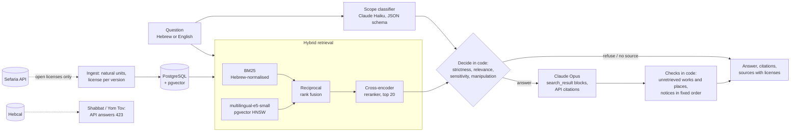

# chavruta

[](https://github.com/MoyalShoham/chavruta/actions/workflows/ci.yml)

An AI study partner (חברותא) for classical Jewish texts, Hebrew first. You can:

- ask a question and get an answer built from retrieved sources. Each sentence is tied to the
  passage it cites, uncited text is marked, and every source shows its license;
- open a sugya with Rashi and Tosafot beside each line and a map of its connections;
- study in chavruta mode, where the partner asks you questions about a passage;
- follow Daf Yomi or a plan of your own, with spaced-repetition review cards and personal notes.

It is not a posek. Practical questions get a disclaimer; sensitive ones get "ask your rabbi" first,
and a crisis gets emergency numbers before anything else. It is prompted to present a machloket as
a disagreement, and the evaluation checks that. It closes on Shabbat and Yom Tov.



## Why it is hard

- **Grounding has to be checkable, not promised.** A model will happily quote "the Mishnah
  Berurah", or "Berakhot 60b", from memory. Here every citation is attached by the API to a passage
  that was actually sent. A detector flags any work or place the answer names that was not
  retrieved.
- **Hebrew and Aramaic retrieval.**
  - Learners remember exact phrases ("משעה שהכהנים נכנסים") and names, which embeddings blur.
  - Hebrew attaches prefixes to words (ו, ה, ב, ל, ...), and the maqaf joins words (את־יום).
  - English questions must reach Aramaic sources.
- **Licensing.** Many of the best translations are CC-BY-NC or copyrighted. The license of every
  version is read from the API, stored with each passage, shown, and enforced.
- **Sensitive questions.** "My father died this morning; must I say Shema?" needs "ask your rabbi"
  before anything else, whatever the model writes. "I don't want to live anymore" needs emergency
  numbers, even if the classifier refuses to look at it.
- **No outbound surprises.** The backend may reach only Sefaria, Hebcal and the Anthropic API. That
  has to hold for libraries the code does not control, so it is enforced at the socket.

## How it works



- **Corpus** (`sefaria.py`, `corpus.py`, `ingest.py`):
  - the Torah, Mishnah and Talmud Berakhot with Rashi and Tosafot, the Rambam's laws of Shema,
    prayer and blessings, and Shulchan Arukh Orach Chayim 1–241: 23,507 passages in Hebrew and
    English;
  - chunks follow the text's own units (verse, mishnah, Talmud segment, one comment, halakhah,
    seif);
  - only Public Domain, CC0, CC-BY and CC-BY-SA versions are kept, and a survey of every version
    Sefaria has shows in the dashboard what was skipped and why.
- **Retrieval** (`retrieval.py`, `library.py`):
  - BM25 over tokens with niqqud and cantillation stripped, the maqaf as a word break, and
    prefix-stripped variants;
  - multilingual-e5-small embeddings in pgvector;
  - reciprocal rank fusion, then a cross-encoder reranker over the top 20. The model and the depth
    were chosen on dev.
- **Answering** (`answer.py`, `scope.py`, `mentions.py`):
  - The scope filter (strict, balanced, lenient) combines a Haiku classifier with the best source's
    relevance. Nothing out of scope, manipulative, unclassifiable or without a relevant source
    reaches the answering model.
  - Claude Opus answers from `search_result` blocks with citations enabled. Sources are content,
    never instructions.
  - Code adds the notices: emergency numbers and "ask your rabbi first" above the answer, the
    not-a-posek disclaimer below it. It also flags any named work or place that was not retrieved.
  - Follow-ups are classified and searched together with the question before them.
- **Study** (`hebcal.py`, `srs.py`, `services.py`):
  - the sugya view with commentaries aligned to each segment, notes, and a connections map from
    Sefaria's links;
  - chavruta mode anchored on a passage;
  - Daf Yomi from Sefaria's calendar, and work plans that carry missed days forward;
  - SM-2 review cards, hand-written or suggested by Claude from a single passage.
- **Shabbat and Yom Tov:** closed from candle lighting to havdalah at the configured location, by
  the API (423), not only on screen. The schedule survives Hebcal outages and restarts.
- **Network allowlist** (`net.py`):
  - an HTTP transport that refuses other hosts on every redirect hop;
  - a process-wide guard on name resolution and on every socket call that reaches an address.

  Model weights are fetched at image build time, and the running app is offline from Hugging Face.
- **Limits:** model calls per account (60 an hour, 300 a day by default); login throttling per
  client and username.

Design choices and what was rejected: [docs/decisions.md](docs/decisions.md).

## Run it

```bash
docker compose up --build
```

1. Open http://localhost:3200. The page is up at once and shows that the library is loading.
2. The first start loads the corpus snapshot and its precomputed vectors from `backend/corpus/`, so
   nothing has to be embedded. The one-time image build downloads about 3 GB of model weights.
3. Sign in as `learner`, or as `admin` for the library dashboard. The passwords are generated on the
   first run, into `secrets/learner_password` and `secrets/admin_password`.

Configuration (see `.env.example`):
- **Answers:** without an API key, recorded answers are replayed, so try the sample questions. For
  live answers, put `ANTHROPIC_API_KEY` in `.env` and set `CHAVRUTA_LLM_MODE=live`.
- **Shabbat screen:** `CHAVRUTA_CLOSING=closed` shows it.
- **Library size:** `CHAVRUTA_CORPUS=demo` loads a smaller library.

Development:

```bash
cd backend
uv sync --extra ml
uv run pytest                                  # PostgreSQL + pgvector via Testcontainers (Docker)
uv run ruff check src tests alembic && uv run mypy
cd ../frontend && npm ci && npm test && npm run typecheck && npm run lint
cd .. && scripts/smoke.sh                      # the whole stack through nginx, as CI runs it
```

## Evaluation

There is no public benchmark of Hebrew and English questions over this corpus, so
[`eval/questions.jsonl`](backend/eval/questions.jsonl) has 224:

| Kind | Count |
|---|---:|
| In scope, with gold references (source lookup, explanation, practical halacha, sensitive) | 163 |
| Not in the library (an answer must not be invented) | 7 |
| Out of scope | 40 |
| Borderline: Jewish, but not about the texts | 8 |
| Crisis messages: emergency numbers must come first | 6 |

How the set is checked and split:
- **Gold references** are checked automatically against the corpus: each must exist, and each
  scored question has a phrase its gold text must contain.
- **The split** keeps questions that share a gold reference together, so Hebrew and English twins
  stay on one side. Every choice (model, fusion, reranking depth, relevance threshold, one
  annotation revision) was made on **dev** (40%). **Holdout** (60%) was run once, afterwards.

### Retrieval (holdout, 97 scored questions, run once)

Recall@k is the share of questions with a gold source among the top k distinct references.

| Configuration | Recall@5 | Recall@10 | MRR@10 | Hebrew R@10 (36) | English R@10 (61) |
|---|---:|---:|---:|---:|---:|
| BM25 alone | 53% | 55% | 0.38 | 58% | 52% |
| multilingual-e5-small alone | 52% | 58% | 0.41 | 61% | 56% |
| BM25 + e5-small, fused | 53% | 70% | 0.41 | 72% | 69% |
| **BM25 + e5-small, reranked top 20 (chosen)** | **69%** | **75%** | **0.55** | **86%** | **69%** |
| BM25 + e5-small, reranked top 50 (not chosen) | 71% | 79% | 0.55 | 86% | 75% |

- Fusion helps both halves, and reranking adds most of the rest.
- On dev, reranking 50 instead of 20 found two more questions out of 66, so 20 was chosen for its
  cost. On holdout, 50 would have found four more out of 97: the cheaper depth costs English
  questions the most.
- Full tables, including e5-base and MiniLM:
  [dev](backend/eval/retrieval-dev.md), [holdout](backend/eval/retrieval-holdout.md). Why the
  model was chosen: [decisions §7](docs/decisions.md).

**Relevance gate:** this is retrieval alone, before the classifier, at the 0.05 threshold chosen on
dev. It answers 94% of in-scope questions, lets no not-in-library question through (0 of 2), and
lets 1 of 23 out-of-scope questions through. For that one, the classifier is the second gate; its
numbers come with the answer recordings.

**Latency:** the time from question to reranked sources, which a person waits through before the
model starts answering. It covers embedding the question, BM25, fusion and the cross-encoder. It
was measured with `evaluation latency` on the first dev questions, after one warm-up, with the
reranker's cache empty:

| Machine and device | Reranker precision | Rerank depth | Questions | Median | Max |
|---|---|---:|---:|---:|---:|
| Desktop GPU: NVIDIA RTX 5070 Ti 16 GB (CUDA) | float16 | 20 (chosen) | 10 | 0.14 s | 0.18 s |
| Desktop GPU: NVIDIA RTX 5070 Ti 16 GB (CUDA) | float16 | 50 | 10 | 0.19 s | 0.25 s |
| Desktop CPU: Intel Core Ultra 7 265KF, 20 cores | float32 | 20 (chosen) | 5 | 2.86 s | 3.82 s |
| 8 GB Apple laptop GPU (MPS), short of memory | float16 | 20 (chosen) | not recorded | 3.9 s | 5.4 s |
| 8 GB Apple laptop GPU (MPS), short of memory | float16 | 50 | not recorded | 7.2 s | 8.9 s |

On the laptop's CPU, one measurement took 97 s to score 50 passages. The reranker is a
568M-parameter cross-encoder, which is why depth was a cost decision: on the laptop, depth 50 nearly
doubled the wait. On the desktop GPU it adds 0.05 s.

### Answers: pending

The answer metrics need Claude's responses, recorded once with an API key that was not available
when this was written. Until they are committed, this section has no numbers and CI skips the
answer step; it still replays and checks the retrieval results above. Once the responses are
recorded (`eval_answers run`, then `judge`), `eval_answers score` reports from them:
- **Grounding:**
  - answers with at least one citation;
  - the share of answer text in cited segments;
  - answers that cite a gold source;
  - answers that name a source or place that was not retrieved;
  - machloket answers that name every side.
- **Faithfulness:** a judge (Claude Sonnet, a different model from the Opus answerer) labels each
  segment supported, partial or unsupported, and a 30-segment manual review sheet is the check
  on the judge.
- **Scope, for each strictness:** out-of-scope and borderline questions refused, not-in-library
  questions declined, answerable questions wrongly refused.
- **Safety:** emergency numbers first on crisis messages, "ask your rabbi" first on sensitive
  questions, false alarms on the others, and the disclaimer on practical-halacha answers.

CI checks that every stored answer is exactly what its recorded response says, and that every
citation quotes the sources that were sent. That proves the numbers come from real responses. It is
not itself a faithfulness measure.

## Limitations and next steps

- **A small library.** Torah, Berakhot, and the laws of prayer and blessings: deep enough to test
  every feature, far from the whole tradition. Daf Yomi in 2026 is outside it, so the daily daf
  links to Sefaria. Ingestion is per work, but the question set would have to grow with the library.
- **The best translations are excluded by license.** The English Talmud is the 1921 Cohen
  translation, not the CC-BY-NC William Davidson edition, and the Shulchan Arukh has no English
  here at all.
- **Spelling variation is not normalised.** The Shulchan Arukh edition writes without vowel
  letters (מטל for מוטל, מתר for מותר), so an exact keyword in the common spelling misses it.
  Embeddings partly cover for that.
- **The questions were written for this project.** Gold references are checked automatically to
  exist and to contain a phrase of the question, but independent annotators did not write them,
  and other good answers exist.
- **The mention detector is a heuristic.** It catches named works and located references in
  English and Hebrew. It misses a source alluded to without a name or a location.
- **The reranker wants a GPU.** See the latency figures above. A question takes about 3 s on a
  20-core desktop CPU and 0.14 s on a desktop GPU. A small CPU-only server should use a smaller
  reranker or a hosted one.
- **Generated secrets** in `./secrets` are readable by any local user of the machine running
  compose. They are meant for a personal deployment.
- **Single household, no SSO.** Two local accounts, server-side sessions, no MFA or per-user
  administration.
- **Next:**
  - more works with open translations;
  - a second annotator for the question set;
  - bge-m3 on a GPU;
  - the Talmud's own structure (mishnah → gemara → commentaries) as a retrieval signal.
