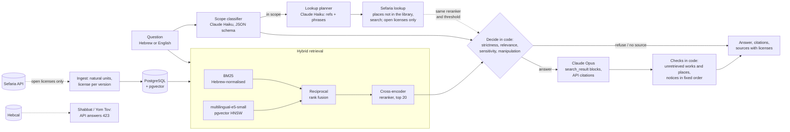

# chavruta

[](https://github.com/MoyalShoham/chavruta/actions/workflows/ci.yml)

An AI study partner (חברותא) for classical Jewish texts, Hebrew first. You can:

- ask a question and get an answer built from retrieved sources. Each sentence is tied to the
  passage it cites, uncited text is marked, and every source shows its license;
- ask about a text outside the curated library ("בבא בתרא דף ה עמוד א"): it is looked up on
  Sefaria for that question, under the same license and grounding rules, and marked as such;
- open a sugya with Rashi and Tosafot beside each line and a map of its connections;
- study in chavruta mode, where the partner asks you questions about a passage;
- follow Daf Yomi or a plan of your own, with spaced-repetition review cards and personal notes.

It is not a posek. Practical questions get a disclaimer; sensitive ones get "ask your rabbi" first,
and a crisis gets emergency numbers before anything else. It is prompted to present a machloket as
a disagreement, and the evaluation checks that. It closes on Shabbat and Yom Tov.


## Why it is hard

- **Grounding has to be checkable, not promised.** A model will happily quote "the Mishnah
  Berurah", or "Berakhot 60b", from memory. Here every citation is attached by the API to a passage
  that was actually sent. A detector flags any work or place the answer names that was not
  retrieved.
- **Hebrew and Aramaic retrieval.**
  - Learners remember exact phrases ("משעה שהכהנים נכנסים") and names, which embeddings blur.
  - Hebrew attaches prefixes to words (ו, ה, ב, ל, ...), and the maqaf joins words (את־יום).
  - English questions must reach Aramaic sources.
- **Licensing.** Many of the best translations are CC-BY-NC or copyrighted. The license of every
  version is read from the API, stored with each passage, shown, and enforced.
- **Sensitive questions.** "My father died this morning; must I say Shema?" needs "ask your rabbi"
  before anything else, whatever the model writes. "I don't want to live anymore" needs emergency
  numbers, even if the classifier refuses to look at it.
- **No outbound surprises.** The backend may reach only Sefaria, Hebcal and the Anthropic API. That
  has to hold for libraries the code does not control, so it is enforced at the socket.
- **Going beyond the library without losing any of that.** Looking a text up for one question must
  keep the license rule, the grounding and the guardrails, and must not change a single request for
  the questions the library already answers, or the recorded evaluation would silently stop
  applying.

## How it works



- **Corpus** (`sefaria.py`, `corpus.py`, `ingest.py`):
  - the Torah, Mishnah and Talmud Berakhot with Rashi and Tosafot, the Rambam's laws of Shema,
    prayer and blessings, and Shulchan Arukh Orach Chayim 1–241: 23,507 passages in Hebrew and
    English;
  - chunks follow the text's own units (verse, mishnah, Talmud segment, one comment, halakhah,
    seif);
  - only Public Domain, CC0, CC-BY and CC-BY-SA versions are kept, and a survey of every version
    Sefaria has shows in the dashboard what was skipped and why.
- **Retrieval** (`retrieval.py`, `library.py`):
  - BM25 over tokens with niqqud and cantillation stripped, the maqaf as a word break, and
    prefix-stripped variants;
  - multilingual-e5-small embeddings in pgvector;
  - reciprocal rank fusion, then a cross-encoder reranker over the top 20. The model and the depth
    were chosen on dev.
- **Answering** (`answer.py`, `scope.py`, `mentions.py`):
  - The scope filter (strict, balanced, lenient) combines a Haiku classifier with the best source's
    relevance. Nothing out of scope, manipulative, unclassifiable or without a relevant source
    reaches the answering model.
  - Claude Opus answers from `search_result` blocks with citations enabled. Sources are content,
    never instructions.
  - Code adds the notices: emergency numbers and "ask your rabbi first" above the answer, the
    not-a-posek disclaimer below it. It also flags any named work or place that was not retrieved.
  - Follow-ups are classified and searched together with the question before them.
- **Beyond the library** (`lookup.py`):
  - Claude Haiku plans a lookup while the library is searched: the Sefaria references the question
    names, and phrases likely to appear in the passage. It never answers.
  - Sefaria resolves each reference. A place the library holds, under any name or as a range, is not
    fetched, so a question the library answers is untouched. Other places are fetched with their
    context (a daf with Rashi and Tosafot, a chapter cut around the verse); phrases go to Sefaria's
    search.
  - Only openly licensed versions; the text of any other is never stored. Fetched passages go
    through the same reranker and relevance threshold, and are marked "From Sefaria".
  - It runs only when the library's best source is weak or the question names something outside
    the library: a question the library answers well is never touched.
  - Bounded (240 passages, 20 seconds) and safe to fail. Refused, borderline and sensitive
    questions are never looked up.
- **Study** (`hebcal.py`, `srs.py`, `services.py`):
  - the sugya view with commentaries aligned to each segment, notes, and a connections map from
    Sefaria's links;
  - chavruta mode anchored on a passage;
  - Daf Yomi from Sefaria's calendar, and work plans that carry missed days forward;
  - SM-2 review cards, hand-written or suggested by Claude from a single passage.
- **Shabbat and Yom Tov:** closed from candle lighting to havdalah at the configured location, by
  the API (423), not only on screen. The schedule survives Hebcal outages and restarts.
- **Network allowlist** (`net.py`):
  - an HTTP transport that refuses other hosts on every redirect hop;
  - a process-wide guard on name resolution and on every socket call that reaches an address.

  Model weights are fetched at image build time, and the running app is offline from Hugging Face.
- **Limits:** model calls per account (60 an hour, 300 a day by default); login throttling per
  client and username.

Design choices and what was rejected: [docs/decisions.md](docs/decisions.md).

## Run it

```bash
docker compose up --build
```

1. Open http://localhost:3200. The page is up at once and shows that the library is loading.
2. The first start loads the corpus snapshot and its precomputed vectors from `backend/corpus/`, so
   nothing has to be embedded. The one-time image build downloads about 3 GB of model weights.
3. Sign in as `learner`, or as `admin` for the library dashboard. The passwords are generated on the
   first run, into `secrets/learner_password` and `secrets/admin_password`.

Configuration (see `.env.example`):
- **Answers:** without an API key, recorded answers are replayed, so try the sample questions. For
  live answers, put `ANTHROPIC_API_KEY` in `.env` and set `CHAVRUTA_LLM_MODE=live`.
- **Shabbat screen:** `CHAVRUTA_CLOSING=closed` shows it.
- **Library size:** `CHAVRUTA_CORPUS=demo` loads a smaller library.
- **Sefaria lookup:** on by default, and needs the API key (the planner is a model call).
  `CHAVRUTA_SEFARIA_LOOKUP=false` answers from the library only.

Development:

```bash
cd backend
uv sync --extra ml
uv run pytest                                  # PostgreSQL + pgvector via Testcontainers (Docker)
uv run ruff check src tests alembic && uv run mypy
cd ../frontend && npm ci && npm test && npm run typecheck && npm run lint
cd .. && scripts/smoke.sh                      # the whole stack through nginx, as CI runs it
```

## Evaluation

There is no public benchmark of Hebrew and English questions over this corpus, so
[`eval/questions.jsonl`](backend/eval/questions.jsonl) has 224:

| Kind | Count |
|---|---:|
| In scope, with gold references (source lookup, explanation, practical halacha, sensitive) | 163 |
| Not in the library (an answer must not be invented) | 7 |
| Out of scope | 40 |
| Borderline: Jewish, but not about the texts | 8 |
| Crisis messages: emergency numbers must come first | 6 |

How the set is checked and split:
- **Gold references** are checked automatically against the corpus: each must exist, and each
  scored question has a phrase its gold text must contain.
- **The split** keeps questions that share a gold reference together, so Hebrew and English twins
  stay on one side. Every choice (model, fusion, reranking depth, relevance threshold, one
  annotation revision) was made on **dev** (40%). **Holdout** (60%) was run once, afterwards.

### Retrieval (holdout, 97 scored questions, run once)

Recall@k is the share of questions with a gold source among the top k distinct references.

| Configuration | Recall@5 | Recall@10 | MRR@10 | Hebrew R@10 (36) | English R@10 (61) |
|---|---:|---:|---:|---:|---:|
| BM25 alone | 53% | 55% | 0.38 | 58% | 52% |
| multilingual-e5-small alone | 52% | 58% | 0.41 | 61% | 56% |
| BM25 + e5-small, fused | 53% | 70% | 0.41 | 72% | 69% |
| **BM25 + e5-small, reranked top 20 (chosen)** | **69%** | **75%** | **0.55** | **86%** | **69%** |
| BM25 + e5-small, reranked top 50 (not chosen) | 71% | 79% | 0.55 | 86% | 75% |

- Fusion helps both halves, and reranking adds most of the rest.
- On dev, reranking 50 instead of 20 found two more questions out of 66, so 20 was chosen for its
  cost. On holdout, 50 would have found four more out of 97: the cheaper depth costs English
  questions the most.
- Full tables, including e5-base and MiniLM:
  [dev](backend/eval/retrieval-dev.md), [holdout](backend/eval/retrieval-holdout.md). Why the
  model was chosen: [decisions §7](docs/decisions.md).
- **bge-m3, added after the holdout run and not used for the choice:** on dev only, on a GPU, it
  beats e5-small. Fused and reranked at depth 20 it reaches 79% recall@10 against 71% (52 against
  47 of 66 questions). It has no holdout number: holdout has been used, so adopting it would need a
  fresh one. See [eval/bge-m3](backend/eval/bge-m3/retrieval-dev.md).

**Relevance gate:** this is retrieval alone, before the classifier, at the 0.05 threshold chosen on
dev. It answers 94% of in-scope questions, lets no not-in-library question through (0 of 2), and
lets 1 of 23 out-of-scope questions through. For that one, the classifier is the second gate. With
both gates, every out-of-scope holdout question was refused (Answers, below).

**Latency:** the time from question to reranked sources, which a person waits through before the
model starts answering. It covers embedding the question, BM25, fusion and the cross-encoder. It
was measured with `evaluation latency` on the first dev questions, after one warm-up, with the
reranker's cache empty:

| Machine and device | Reranker precision | Rerank depth | Questions | Median | Max |
|---|---|---:|---:|---:|---:|
| Desktop GPU: NVIDIA RTX 5070 Ti 16 GB (CUDA) | float16 | 20 (chosen) | 10 | 0.14 s | 0.18 s |
| Desktop GPU: NVIDIA RTX 5070 Ti 16 GB (CUDA) | float16 | 50 | 10 | 0.19 s | 0.25 s |
| Desktop CPU: Intel Core Ultra 7 265KF, 20 cores | float32 | 20 (chosen) | 5 | 2.86 s | 3.82 s |
| 8 GB Apple laptop GPU (MPS), short of memory | float16 | 20 (chosen) | not recorded | 3.9 s | 5.4 s |
| 8 GB Apple laptop GPU (MPS), short of memory | float16 | 50 | not recorded | 7.2 s | 8.9 s |

On the laptop's CPU, one measurement took 97 s to score 50 passages. The reranker is a
568M-parameter cross-encoder, which is why depth was a cost decision: on the laptop, depth 50 nearly
doubled the wait. On the desktop GPU it adds 0.05 s.

### Answers (holdout, 129 questions, run once)

These answers are the curated library alone, with the Sefaria lookup off; what the lookup changes
on these same questions is measured in the next section. Each question went through the whole
app:
- Claude Haiku classifies it;
- retrieval finds sources;
- Claude Opus answers with API citations;
- Claude Sonnet, a different model, judges each segment of the answer against the sources sent.

Every response is recorded (`eval/recordings/llm`). Dev and holdout together cost about $9. Full
reports: [dev](backend/eval/answers-dev.md), [holdout](backend/eval/answers-holdout.md).

| Holdout | Value |
|---|---:|
| Answered (the rest were refused or had no relevant source) | 94 of 129 |
| Answers with at least one API citation | 100% |
| Answers citing a gold source | 78% |
| Judge: claims fully supported / partly / unsupported (1,002 claims) | 89% / 11% / 0.4% |
| Answers flagged for naming a source that was not retrieved | 7 (7%) |
| Out-of-scope questions refused (23) / not-in-library declined (2), default strictness | 100% / 100% |
| Answerable questions refused | 6% (6 of 97) |
| Crisis messages with emergency numbers first (3) / sensitive with "ask your rabbi" first (2) | 3 / 2 |
| Practical-halacha answers with the not-a-posek disclaimer | 95% (21 of 22) |

What this does and does not show:

- **Faithfulness is judged by a model.** The judge is a different model from the answerer and sees
  only the sources sent. It is still a model, so
  [a 30-segment manual review sheet](backend/eval/manual-review-holdout.md) is its check. That
  review has not been filled in yet; until it is, the 89% is the judge's number alone.
- **About half of the answer text is outside cited segments (48% is cited).** That part is mostly
  questions back to the learner, transitions and the disclaimer: the judge labels 27% of segments
  "no claim". The integrity check covers only what is cited.
- **I read all 7 flagged answers.**
  - Two gave the location of a verse that a retrieved passage quotes without naming it ("Devarim
    16:3", "Deut. 26:11"). That came from the model's memory, which is what the check is for.
  - Five were false alarms of the detector:
    - three wrote a Rambam book as "Hilchot Tefillah" or "Hilchot Keriat Shema", and the book had
      been retrieved;
    - one said the Rambam was *not* among its sources;
    - one wrote "תוספות על ברכות ו.", a form the dev fix ([decisions §3](docs/decisions.md)) does
      not cover.

  They are left as they are, because changing the detector after holdout would tune it on holdout.
- **The missing disclaimer:** the classifier read "מה דין ברכת התורה לפני הלימוד בבוקר?" as text
  study, not as a practical question, so no disclaimer was shown.
- **"Ask your rabbi" also appeared on 4 of 89 ordinary text questions:** about an onen, the death
  of Rabbi Akiva, an ill person, and danger to life. They are themes, not personal situations. It is
  the cautious direction.
- **Borderline questions depend on strictness.** At the default (balanced) strictness 1 of 4 was
  refused, at strict all 4. That is the choice the setting exists for.
- **Dev and holdout agree.** On dev (95 questions): 91% supported, 0 false "ask your rabbi", every
  disclaimer present. Nothing about the answering was changed after dev. The only change was the
  mention detector's parsing ([decisions §3](docs/decisions.md)).

CI replays every stored answer against its recorded response, checks that every citation quotes the
sources that were sent, and recomputes these reports (`eval_answers score --check`). That proves the
numbers come from real responses. It is not itself a faithfulness measure.

### Beyond the library: the Sefaria lookup (holdout, 21 questions, run once)

[`eval/lookup-questions.jsonl`](backend/eval/lookup-questions.jsonl) has 45 questions about texts
outside the library, split 24 dev / 21 holdout with no gold place or topic shared across the split
(nor with the main dev set):
- **named places**, in learner forms ("בבא מציעא דף נט עמוד ב", "סנהדרין לז ע\"א", "Kiddushin
  29a", "רמב\"ם הלכות תשובה פרק ב הלכה ב");
- **well-known passages asked about without a place** ("Where does the Talmud tell of Hillel
  teaching a convert on one foot?");
- **topics** ("Where does the Talmud state that the law of the kingdom is the law?");
- **places that do not exist** ("Shabbat 550a"), where the right outcome is no answer.

Every gold place is checked against Sefaria's openly licensed Hebrew text. Each question went
through the whole app with the lookup on, and the same Sonnet judge read the answers. Every Sefaria
response and model response is recorded, and CI replays them. Full reports:
[dev](backend/eval/lookup-dev.md), [holdout](backend/eval/lookup-holdout.md).

| Holdout | Value |
|---|---:|
| Gold passage fetched / sent to the model / cited in the answer (19 with a gold place) | 19 / 19 / 19 |
| Answered (19 with a gold place) | 19 of 19 |
| Judge: claims fully supported by the sources sent (20 answers) | 90% |
| Licenses of every source sent | Public Domain, CC0, CC-BY, CC-BY-SA |
| Places that do not exist: declined | 1 of 2 |
| Answers flagged for naming a source that was not sent | 3 of 20 |
| Fetching from Sefaria, uncached: median / max | 3.8 s / 7.4 s |

The planner (median 1.4 s) runs while the library is searched, so it adds no wait of its own.

**On the library's own questions** (`eval_lookup library`, the main holdout's 129 questions with the
lookup on, stopped before the answering model):
- 83 of the 94 questions the library answered send a byte-identical request, so their recorded
  answers above stand.
- The other 11 get a fetched source, because the library's best source was weak or the question
  named something outside it. Their new answers are not recorded or judged.
- Gold sources: one the library had sent is no longer sent (q095, the vatikin, Berakhot 9b, pushed
  out by Ein Yaakov, the Tosefta and the Tur), and three questions the library had declined are now
  answered with their gold.
- Both not-in-library questions are now answered from Sefaria, which is the point. The "not in
  library declined 100%" above is the library alone.

What this does and does not show:

- **Holdout is mostly named places** (13 of 19), the case the lookup is built for. Topics are the
  weak kind, because they depend on the planner's phrases finding the passage in Sefaria's search.
  On dev, 2 of 4 topic questions failed. In one, a library verse scored 0.65 for "אני מצאתיה", and
  a strong library source deliberately stops the lookup. In the other, the right line (דינא
  דמלכותא דינא) was fetched but scored under the relevance threshold, so the honest answer was "no
  source".
- **Dev was run five times.** Each change, and the measurement that caused it, is in
  [decisions §15](docs/decisions.md):
  - ranking fetched passages without vowel points, and with the planner's phrases;
  - searching when the library is weak;
  - never touching a question the library answers well;
  - fetching a place whose book the question names;
  - not counting "the Rambam" as naming one of his books.

  Dev ended at 20 of 22 gold passages sent and 92% supported. Holdout was run once, after all of
  them.
- **I read the 3 flagged answers.**
  - Two are the detector misreading what was sent: Rambam books written as "Hilchot De'ot" and
    "Hilchot Evel", and the dafs of a Tosafot that was sent.
  - The third names Leviticus 19:18, the verse a retrieved Kli Yakar comments on, though the verse
    itself was not sent.
- **The place that does not exist and was "answered"** (Rashi on Bava Kamma 400b) was answered
  with: the sources don't include Bava Kamma, and 400b is probably a typo. Nothing was invented, but
  it is counted as answered.
- **19 of 19 is 19 questions,** written for this project, like the rest.

## Limitations and next steps

- **A small library, and a lookup for the rest.** The curated, measured library is Torah, Berakhot,
  and the laws of prayer and blessings. Anything else is looked up on Sefaria per question, which
  is measured on 45 questions, not on the scale of the library's 224. Daf Yomi in 2026 is outside
  the library, so the daily daf links to Sefaria.
- **The lookup is a second, less tested path.** Its ranking differs from the library's (no vowel
  points, the planner's phrases added), it depends on a model planning references, and its cache
  of Sefaria responses grows without bound and is never re-read for license changes. It sends the
  planned references and phrases, which come from the question, to Sefaria.
- **The best translations are excluded by license.** The English Talmud is the 1921 Cohen
  translation, not the CC-BY-NC William Davidson edition, and the Shulchan Arukh has no English
  here at all.
- **Spelling variation is not normalised.** The Shulchan Arukh edition writes without vowel
  letters (מטל for מוטל, מתר for מותר), so an exact keyword in the common spelling misses it.
  Embeddings partly cover for that.
- **The questions were written for this project.** Gold references are checked automatically to
  exist and to contain a phrase of the question, but independent annotators did not write them,
  and other good answers exist.
- **The mention detector is a heuristic.** It catches named works and located references in
  English and Hebrew. It misses a source alluded to without a name or a location.
- **The reranker wants a GPU.** See the latency figures above. A question takes about 3 s on a
  20-core desktop CPU and 0.14 s on a desktop GPU. A small CPU-only server should use a smaller
  reranker or a hosted one.
- **Generated secrets** in `./secrets` are readable by any local user of the machine running
  compose. They are meant for a personal deployment.
- **Single household, no SSO.** Two local accounts, server-side sessions, no MFA or per-user
  administration.
- **Next:**
  - more works with open translations, chosen by what learners look up most;
  - a second annotator for the question set;
  - bge-m3, which is better on dev (above), chosen properly with a new holdout set;
  - the Talmud's own structure (mishnah → gemara → commentaries) as a retrieval signal.
